# Octavo

A desktop reader for EPUB and PDF books. Your library is a gallery of covers; an EPUB and a PDF of
the same book share one card; highlights, notes and bookmarks record the printed page they are on;
and a book's highlights export to an Obsidian note in one click. Everything stays in a folder on
your disk: no accounts, no network.

Built with Electron, React and TypeScript. EPUBs render with
[foliate-js](https://github.com/johnfactotum/foliate-js), PDFs with
[pdf.js](https://github.com/mozilla/pdf.js). Runs on Windows and Linux: developed on Windows 11,
and every build is tested on both.

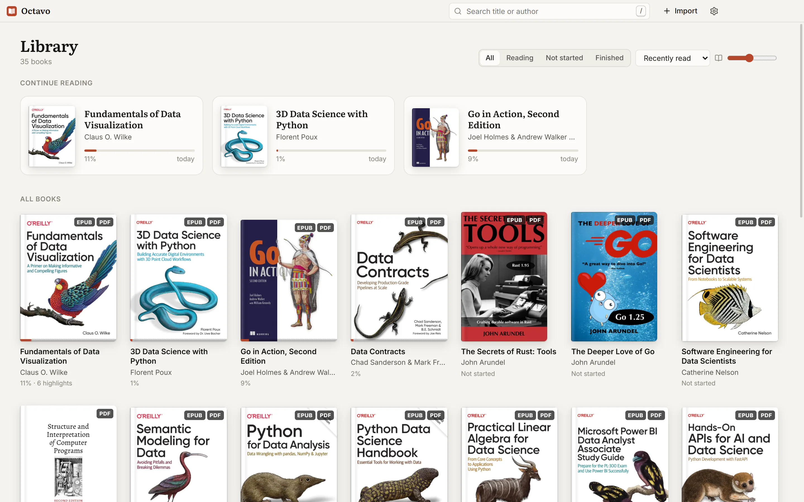

## What it does

- **A library folder you own.** Octavo copies books into its own folder. Import files, whole
  folders, or the `.zip` archives Google Drive makes when you download a folder. Formats are
  recognised by content, so a PDF without a file extension still works, and importing the same book
  twice is caught by its content hash.
- **One card per book.** An EPUB and a PDF of the same book are paired by file name or by title and
  share a card. Switch between them in the reader with the EPUB / PDF control.
- **Covers at their own shape.** Every cover is drawn whole at its own proportions, so nothing is
  cropped. Titles, authors and covers come from the files themselves, cleaned of the usual noise
  (ISBNs in titles, "Surname, Given", "A & B" author strings). Anything still wrong can be corrected
  by hand without touching the file.
- **Reading EPUBs.** One page, two pages or continuous scrolling; the publisher's font, Literata or
  Inter; text size, line spacing, line length, and justified, hyphenated text.
- **Reading PDFs.** Continuous scrolling, fit to width or page, zoom, the outline as a table of
  contents, and inverted pages for reading at night.
- **Paper, sepia and night pages.** The page theme covers the whole reading area, its bar and the
  window buttons. The library and dialogs follow the system light or dark theme, or one you pick.
- **Highlights and notes.** Select text to highlight it in one of five colours, add a note, or copy
  it. Click a highlight to recolour it, edit its note or delete it.
- **Printed page numbers.** Highlights and bookmarks say "p. 112", the page in the print edition,
  instead of an opaque location. See [Page numbers](#page-numbers).
- **Obsidian export.** A book's highlights and notes become one Markdown note in your vault, grouped
  by chapter, with the page of each.
- **Private and offline.** Octavo makes no network requests, and scripts inside EPUBs do not run.

## A look around

### The library

The "Continue reading" shelf holds the books in progress. Below it, every book: search by title or
author (<kbd>/</kbd>), sort by recently read, recently added, title or author, filter by All /
Reading / Not started / Finished, and size the covers with the slider. A card shows its progress and
how many highlights it has. The library follows the system's light or dark theme.

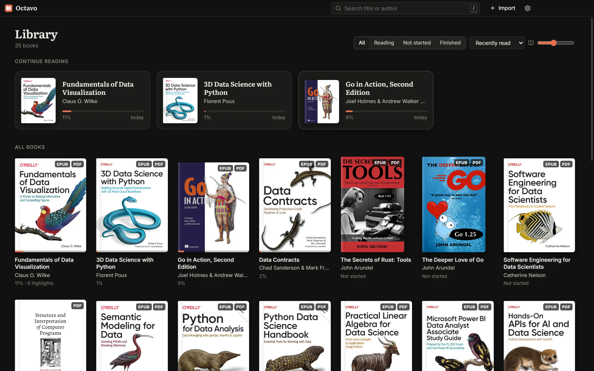

Right-click a card to open either format, fix its title and authors, mark it finished, export its
highlights, show it in its folder, or remove it (the files go to the Recycle Bin or Trash). The PDF of Beej's
guide called itself "Bgc Usl C 1"; the editor shows what the file says and keeps the correction
separately.

<p>
  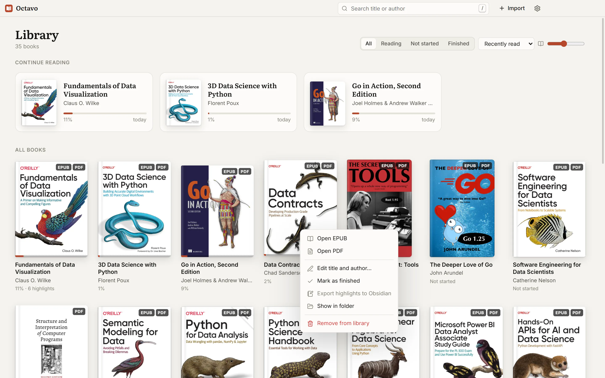
  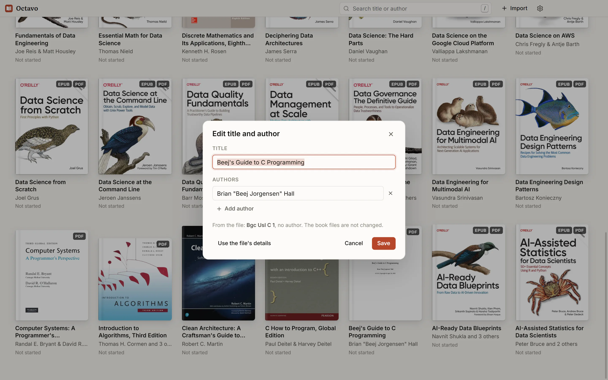
</p>

### Reading

An EPUB in the two-page layout on the paper theme. The bar names the book and the section; the
footer has a scrubber with a tick for each chapter, and the printed page.

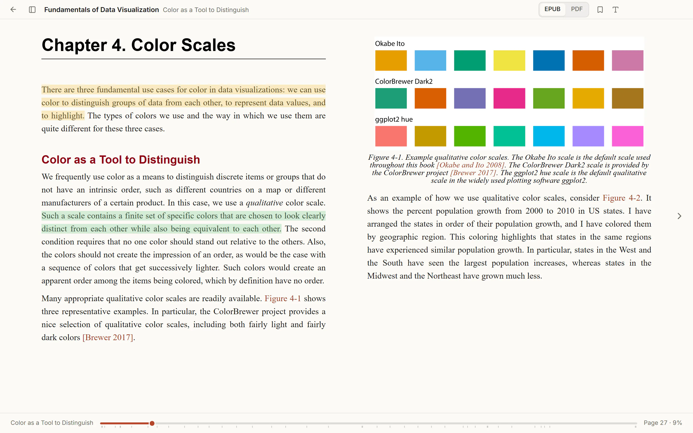

### Highlights and notes

Select text and pick a colour; add a note in the same popover. The sidebar (<kbd>Ctrl</kbd>+<kbd>\\</kbd>)
lists the book's contents, bookmarks and highlights. Each highlight shows its note, page and
chapter, and clicking one goes there.

<p>
  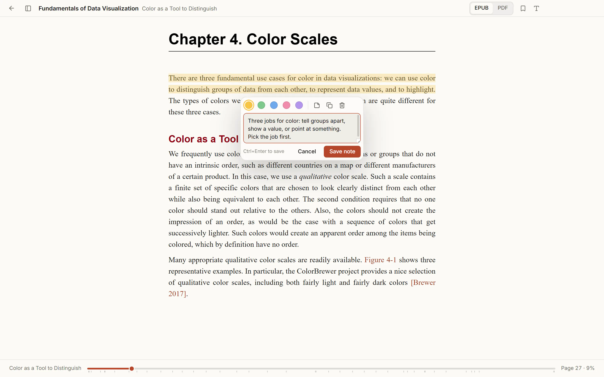
  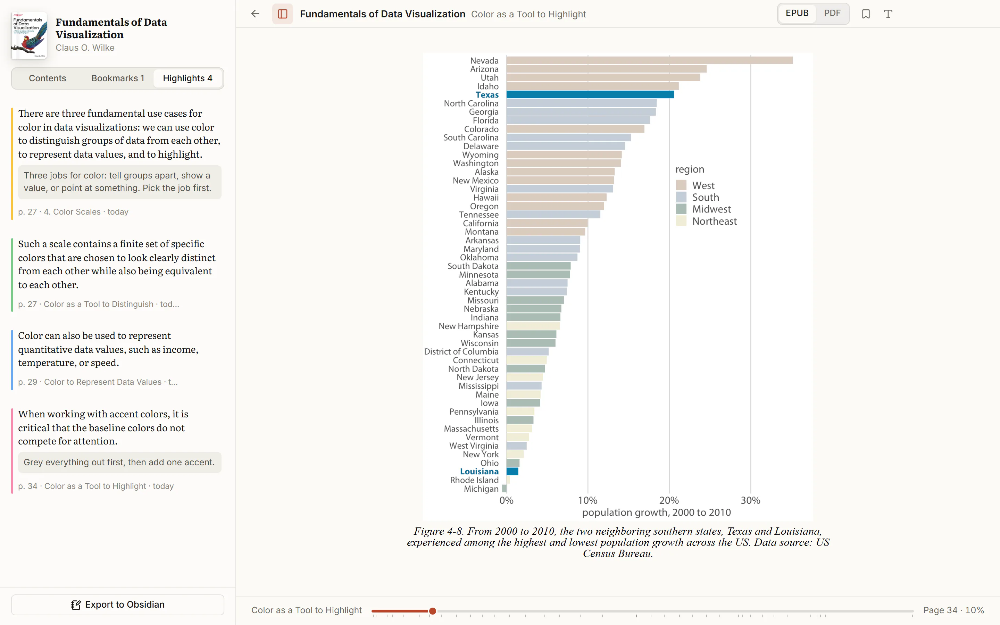
</p>

### Page themes and appearance

The **Aa** button sets the page theme, font, text size, line spacing, line length and layout.

<p>
  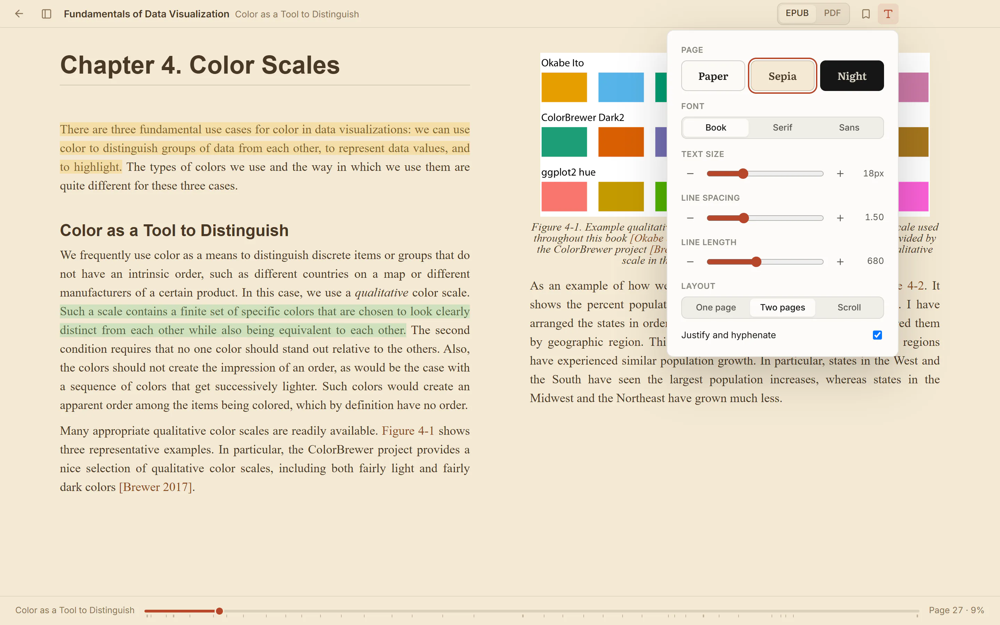
  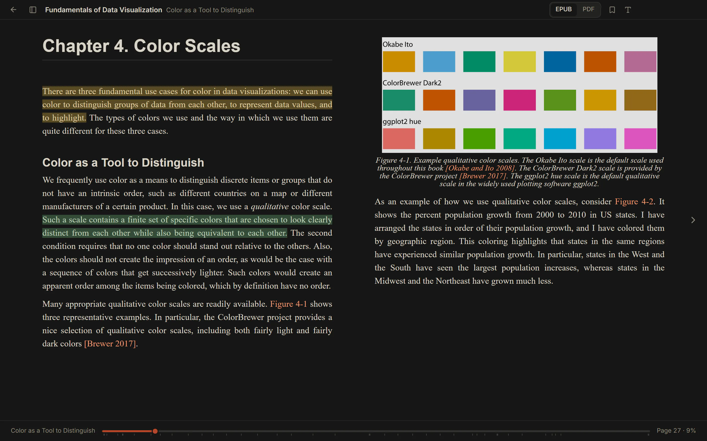
</p>

### PDFs

The PDF of the same book, at the same chapter. Highlights are stored in PDF coordinates, so they stay
on their words at any zoom.

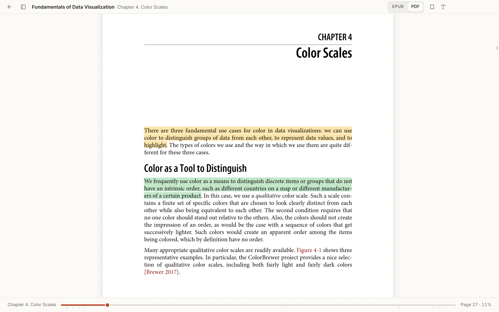

### Settings

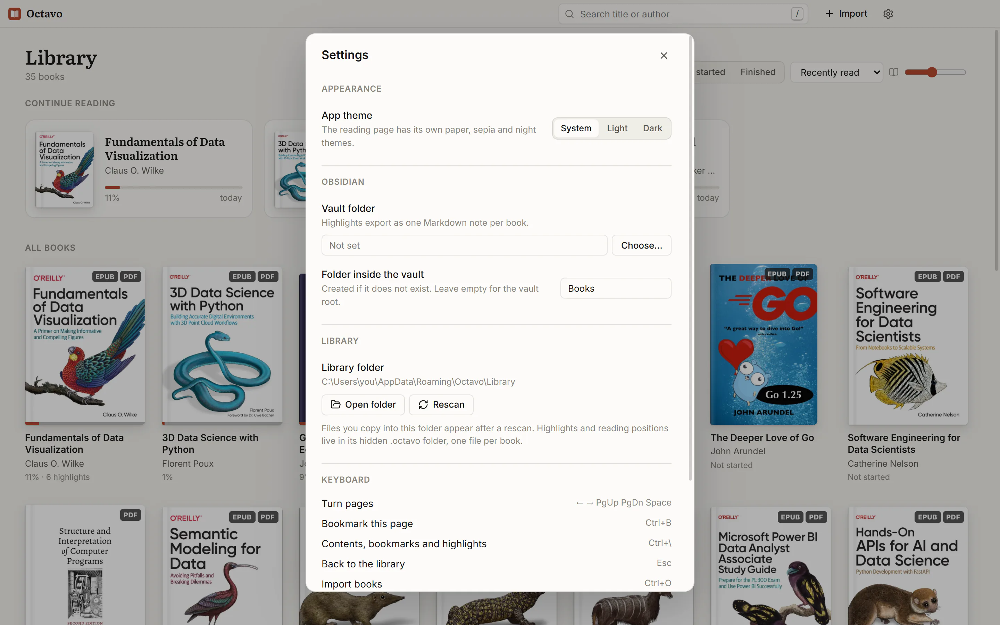

The screenshots show a real library. The pages in them are from Claus O. Wilke's *Fundamentals of
Data Visualization* (O'Reilly, 2019), which is also free to read at
[clauswilke.com/dataviz](https://clauswilke.com/dataviz/) under CC BY-NC-ND 4.0; the highlights and
notes are there for illustration. Cover art belongs to its publishers.

## Install

Download the latest version from [Releases](https://github.com/mckenzie-andrew/Octavo/releases):

- **Windows:** `Octavo-<version>-setup.exe`. The installer is not code-signed, so SmartScreen asks
  before running it ("More info", then "Run anyway").
- **Linux:** `Octavo-<version>.AppImage`. Make it executable and run it:
  `chmod +x Octavo-*.AppImage && ./Octavo-*.AppImage`. AppImages need FUSE 2: on Ubuntu, install
  `libfuse2` (`libfuse2t64` on 24.04 and later).
- **macOS:** not yet. The code has the Mac window controls and menu, but Octavo has not been run on
  a Mac, and macOS blocks apps that are not signed and notarised by Apple.

Each release lists the files' SHA-256 checksums in `SHA256SUMS.txt`.

### Building it yourself

You need [Node.js](https://nodejs.org) 22 or newer and git:

```sh
git clone https://github.com/mckenzie-andrew/Octavo.git
cd Octavo
npm install
npm run package:win      # Windows: dist/Octavo-<version>-setup.exe
npm run package:linux    # Linux: dist/Octavo-<version>.AppImage
```

The Linux package has to be built on Linux. To skip the installer on Windows, build a folder and run
`Octavo.exe` from it:

```sh
npm run build
npx electron-builder --win --dir   # dist/win-unpacked/Octavo.exe
```

## Getting books in

Drop EPUB or PDF files, folders, or `.zip` archives anywhere on the window, or use **Import**
(<kbd>Ctrl</kbd>+<kbd>O</kbd>). Octavo copies the books into its library folder, keeping the folders
they came in, and skips duplicates and anything that is not a book. Files copied into the library
folder by hand appear after a rescan (<kbd>Ctrl</kbd>+<kbd>R</kbd>).

Two files become one book when they sit in the same folder with the same name, ignoring case and
punctuation (`datacontracts.epub` and `datacontracts.pdf`), or when an EPUB and a PDF have the same
title. The EPUB supplies the title, authors and cover; the PDF fills any gaps. A card opens the
format you read last.

To fix a book's title or authors, right-click its card and choose **Edit title and author…**. The
correction is stored in Octavo's catalogue, survives re-reading the files, and can be dropped again
with **Use the file's details**. Book files are never written to.

## Reading

| Keys | |
| --- | --- |
| <kbd>←</kbd> <kbd>→</kbd> <kbd>PgUp</kbd> <kbd>PgDn</kbd> <kbd>Space</kbd> | Turn pages |
| <kbd>Ctrl</kbd>+<kbd>B</kbd> | Bookmark the page |
| <kbd>Ctrl</kbd>+<kbd>\\</kbd> | Contents, bookmarks and highlights |
| <kbd>Esc</kbd> | Back to the library |
| <kbd>/</kbd> or <kbd>Ctrl</kbd>+<kbd>F</kbd> | Search the library |
| <kbd>Ctrl</kbd>+<kbd>O</kbd> | Import books |
| <kbd>Ctrl</kbd>+<kbd>R</kbd> | Rescan the library folder |
| <kbd>Ctrl</kbd>+<kbd>,</kbd> | Settings |

Reading positions are saved as you go, per file, and a book reopens where you left it.

## Page numbers

E-book readers usually place a passage by "location" or percentage, because an EPUB has no fixed
pages: they depend on the window and the font size. Octavo records the page of the print edition
instead.

- **PDF:** the page's own label from the PDF, so front matter reads "xii" and the body "112".
- **EPUB with a PDF of the same book:** EPUBs rarely carry the print edition's page numbers, so
  Octavo extracts the text of each PDF page once and finds the highlighted passage there. Text is
  compared as plain letters and digits, which absorbs hyphenation, ligatures, curly quotes and
  spacing. On a library of 28 EPUB and PDF pairs, all 1,680 sampled paragraphs were found.
- **EPUB on its own:** the footer shows the EPUB's own page numbers if it has them, otherwise a
  location ("Loc 31 of 410"): a fixed slice of about 1,500 characters that does not move when you
  change the font size.

Highlights made before a page was known are filled in the next time the book is opened.

## Obsidian

Choose your vault in Settings (<kbd>Ctrl</kbd>+<kbd>,</kbd>). **Export to Obsidian**, in the
reader's Highlights tab or a card's right-click menu, writes `<vault>/Books/<Title>.md`; the
subfolder is a setting. The note looks like this (the start of the export from the screenshots):

```markdown
---
title: "Fundamentals of Data Visualization"
author: "Claus O. Wilke"
source: octavo
highlights: 6
exported: 2026-11-01
---

# Fundamentals of Data Visualization

*Claus O. Wilke*

## From the EPUB

### 4. Color Scales

> There are three fundamental use cases for color in data visualizations: we can use color to
> distinguish groups of data from each other, to represent data values, and to highlight.

Three jobs for color: tell groups apart, show a value, or point at something. Pick the job first.

*p. 27*
```

Highlights are grouped by chapter in reading order, with a section per format when a book has
highlights in both. Octavo overwrites a note only if its front matter says `source: octavo`;
otherwise it writes `<Title> (Octavo).md` beside it, so a note you wrote yourself is never replaced.

## Where your data lives

Octavo's folder is `%APPDATA%\Octavo` on Windows and `~/.config/Octavo` on Linux:

```
Octavo/
  settings.json               appearance, gallery, Obsidian vault
  Library/
    <your books, as imported: files and folders>
    .octavo/
      catalog.json            every book file, its metadata and any title you corrected
      covers/<id>.webp        cover thumbnails
      annotations/<id>.json   highlights, notes, bookmarks and reading position
      pages/<id>.json         PDFs only: page labels and page text for page numbers
```

`<id>` is the start of the file's SHA-256, so highlights belong to a book's content, not its file
name: renaming or moving a file inside the library keeps them. Annotation files are plain JSON,
written atomically. [DESIGN.md](DESIGN.md) documents every format.

## Privacy and security

- Octavo makes no network requests. The main process cancels any http(s) or WebSocket request from
  the window, and the content security policy names no remote origin, so an EPUB cannot load
  remote images, fonts or styles either. There are no accounts, telemetry or update checks.
- EPUBs can contain scripts. They do not run: the page CSP allows no inline or book scripts.
- The window runs with `contextIsolation` and `sandbox`, without Node. Books are served by a
  private `octavo-book://` protocol by content id, never by path, so the window cannot read files
  outside the library.
- `npm run smoke` checks the first two with a hostile fixture EPUB (an inline script, an `onerror`
  handler, remote script, stylesheet and image) pointed at a local trap server: opening it runs
  nothing and the server sees no request.

## Development

```sh
npm install
npm run electron:fetch   # Electron downloads its binary on demand
npm run dev              # hot-reloading app
npm test                 # unit tests (node:test)
npm run typecheck
npm run smoke            # builds, generates fixture books, drives the real app, screenshots to screenshots/
npm run package:win      # Windows installer in dist/
npm run package:linux    # Linux AppImage in dist/ (on Linux)
```

`scripts/try-books.ts` imports any files you give it into a throwaway library and screenshots them;
set `OCTAVO_EXE` to try a packaged build.

| Environment variable | |
| --- | --- |
| `OCTAVO_USER_DATA` | Profile folder (settings and browser data). The library defaults to `Library` inside it. |
| `OCTAVO_LIBRARY_DIR` | Library folder. |

When launching Electron from a VS Code terminal, unset `ELECTRON_RUN_AS_NODE`: VS Code sets it, and
it turns Electron into plain Node.

## Releases and changelog

Versions follow [Semantic Versioning](https://semver.org) and are derived from
[Conventional Commits](https://www.conventionalcommits.org) (`feat:`, `fix:`, `docs:` and so on);
[CHANGELOG.md](CHANGELOG.md) is generated from the commit history by
[git-cliff](https://git-cliff.org).

```sh
npm run release -- --dry-run   # show the next version and its changelog entry
npm run release                # set the version, write CHANGELOG.md, commit and tag
git push --follow-tags
```

[`.github/workflows/build.yml`](.github/workflows/build.yml) does the rest. Every push to main and
every pull request runs the type check, the unit tests and the smoke run on Windows and Linux and
packages both. A pushed version tag also publishes the Windows installer, the Linux AppImage and
their checksums as a GitHub release, with the changelog entry as its notes.

## Not yet

Full-text search inside a book, pairing and unpairing books by hand, collections or tags, watching
the library folder instead of rescanning, a macOS build, automatic updates. Run one copy of Octavo
at a time: two windows on the same library would both write its catalogue.

## License

Copyright (C) 2026 Andrew McKenzie

Octavo is free software: you can redistribute it and/or modify it under the terms of the GNU
General Public License as published by the Free Software Foundation, either version 3 of the
License, or (at your option) any later version. It is distributed in the hope that it will be
useful, but WITHOUT ANY WARRANTY; without even the implied warranty of MERCHANTABILITY or FITNESS
FOR A PARTICULAR PURPOSE. See [LICENSE](LICENSE) for the full text.

The name "Octavo" and the Octavo logo are not covered by this license. Please give a fork its own
name and mark.

foliate-js is MIT-licensed and pdf.js Apache-2.0. The bundled typefaces, Inter and Literata, are
under the SIL Open Font License 1.1, and the icons are [Lucide](https://lucide.dev) (ISC). Every
bundled package, font and pdf.js asset is listed with its license in
[THIRD_PARTY_LICENSES.md](THIRD_PARTY_LICENSES.md), which ships with each build; regenerate it with
`npm run licenses` after changing dependencies.

## Project layout

```
src/shared     book pairing, metadata clean-up, page matching, Markdown export, highlight geometry, types
src/main       Electron main process: window, menu, IPC, library folder and catalogue, settings, Obsidian
src/preload    the window.octavo bridge exposed to the renderer
src/renderer   React app: gallery, reader with the foliate-js and pdf.js engines, metadata indexer, styles
scripts/       unit tests, fixture books, smoke run, try-books, pdf.js asset copy, icons, notices, release
resources/     app icon: icon.svg is the source, npm run icons renders icon.png / .ico / .icns
docs/          screenshots for this README
.github/       the build, test and release workflow
cliff.toml     git-cliff configuration: changelog groups and version-bump rules
DESIGN.md      the decisions, the data formats and how each feature works
```
